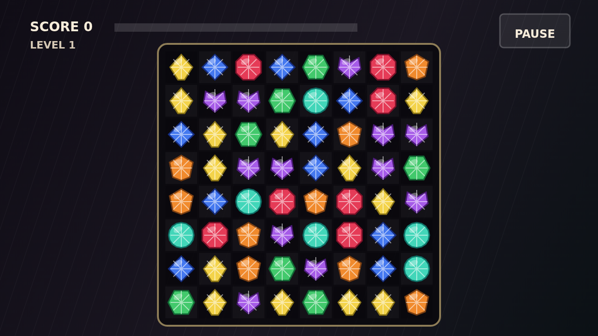

# Facet

Facet is a gem-matching puzzle where every swap is a little act of pressure.
Match three or more stones in a row to shatter them, then watch the board settle
as new gems fall into the gaps.

The twist is strain. Stones beside a clear crack deeper, and once a gem is
flawed it will shatter with any clear that touches it. Good play means setting
up a brittle patch of board, then breaking it open for a chain that keeps
climbing in value.

Special cuts reward strong matches. Four in a line leaves a brilliant that
bursts around itself, five or more creates a prism that can sweep a whole kind,
and crossing lines create a star that cuts through its row and column.

Each level asks for a higher score target, and the round lasts until the board
has no clearing swap left. Read the cracks, spend the cuts, and let pressure
find the flaw.
